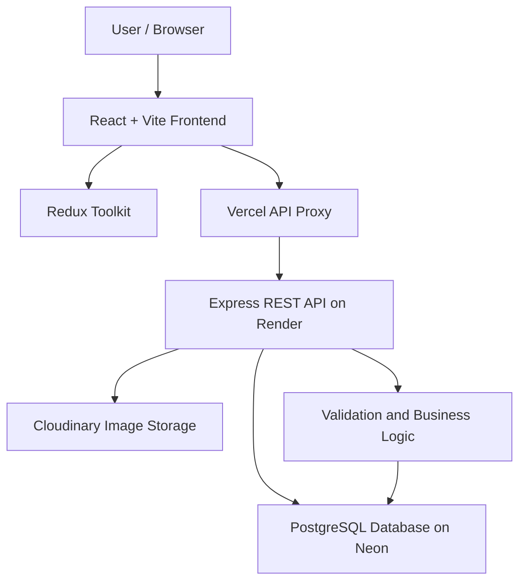

# Namlatic Hotel Owner Portal

A full-stack hotel inventory management dashboard built with React, Redux Toolkit, Node.js, Express.js, and PostgreSQL. The application enables hotel owners to manage hotel listings, upload images, search and filter inventory, and view hotel locations on an interactive map.

## Live Demo

| Resource | Link |
| --- | --- |
| **Live Application** | https://namlatic-hotel.vercel.app |
| **GitHub Repository** | https://github.com/elango-project/Namlatic-Hotel |
| **Demo Video** | [Watch the project demonstration](https://drive.google.com/file/d/13cJOvrDkJp04XS0jZd7YaeOpSqPNx4zU/view?usp=sharing) |

### Evaluation Login

Use the following credentials to access the deployed evaluation account:

| Field | Value |
| --- | --- |
| **Email** | `owner@namlatic.com` |
| **Password** | `OwnerPassword123!` |

> [!NOTE]
> **Security note:** These are evaluation credentials. Do not use this account for sensitive information or real customer data.

## Project Overview

The Namlatic Hotel Owner Portal is a hotel inventory management application designed to help hotel owners manage their hotel listings through a centralized dashboard.

The application provides hotel CRUD operations, image uploading, server-side search and filtering, pagination, price filtering, and location visualization.

The project focuses on practical full-stack development, REST API design, PostgreSQL database operations using native SQL, backend validation, image processing, and responsive frontend development.

## Key Features

- **Hotel Management:** Create, view, update, and delete hotel listings.
- **Image Upload:** Upload hotel images with preview functionality and image processing.
- **Hotel Information:** Manage hotel title, description, price, latitude, and longitude.
- **Search:** Search hotel listings by title.
- **Price Filtering:** Filter hotel listings using minimum and maximum price values.
- **Backend Pagination:** Retrieve paginated results through server-side limit and offset.
- **Location Mapping:** Display hotel locations using an interactive map.
- **Form Validation:** Validate user input on both frontend and backend.
- **Responsive Interface:** Adapt the dashboard layout for desktop, tablet, and mobile screens.
- **Page Metadata:** Manage page titles and metadata using React Helmet.

## Technology Stack

| Layer | Technologies |
| --- | --- |
| **Frontend** | React, Vite |
| **State Management** | Redux Toolkit |
| **Routing** | React Router |
| **Page Metadata** | React Helmet |
| **Backend** | Node.js, Express.js |
| **Database** | PostgreSQL |
| **Database Access** | Native SQL using PostgreSQL driver (no ORM) |
| **Image Upload** | Multer |
| **Image Processing** | Sharp |
| **Image Storage** | Cloudinary in production; local filesystem adapter for development |
| **Maps** | Leaflet |
| **Frontend Testing** | Vitest |
| **Backend Testing** | Node.js test runner |
| **Frontend Hosting** | Vercel |
| **Backend Hosting** | Render |
| **Database Hosting** | Neon |

## Application Architecture



### Request Flow

1. The user interacts with the React frontend.
2. Redux Toolkit manages the frontend application state.
3. API requests are routed through the Vercel proxy to the Express backend.
4. The backend validates incoming requests and processes business logic.
5. PostgreSQL stores and retrieves hotel information using native SQL queries.
6. Production hotel images are stored using Cloudinary.
7. The backend returns the processed response to the frontend.

## Local Quick Start Guide

Follow these steps to run the application locally.

### Prerequisites

- Node.js v22.0.0 or later
- PostgreSQL v16.0 or later
- Git
- npm

### 1. Clone the Repository

Open a terminal and clone the project:

```bash
git clone https://github.com/elango-project/Namlatic-Hotel.git
cd Namlatic-Hotel
```

### 2. Set Up PostgreSQL

Start your PostgreSQL server and connect using an administrative account:

```bash
psql -U postgres
```

Create the application user and database inside the PostgreSQL prompt:

```sql
CREATE USER namlatic_app WITH PASSWORD 'your_secure_password';
CREATE DATABASE namlatic_hotel OWNER namlatic_app;
```

Exit the PostgreSQL prompt:

```text
\q
```

Apply the database initialization script from the project root:

```bash
psql -U namlatic_app -d namlatic_hotel -f server/src/database/init.sql
```

### 3. Configure and Start the Backend

Open a terminal in the project root:

```bash
cd server
npm install
```

Create your local environment file:

```bash
cp .env.example .env
```

For Windows Command Prompt, use:

```cmd
copy .env.example .env
```

Update the `.env` file with your local PostgreSQL credentials and the other required environment variables.

Start the backend:

```bash
npm run dev
```

The backend is expected to run at:
`http://localhost:5000`

### 4. Create a Local Owner Account

With the backend environment configured and the database running, execute the bootstrap command from the server directory:

```bash
npm run db:bootstrap
```

This initializes the local owner account according to the backend bootstrap configuration.

### 5. Configure and Start the Frontend

Open a second terminal in the project root:

```bash
cd client
npm install
npm run dev
```

The frontend is expected to run at:
`http://localhost:5173`

Open the application in your browser and sign in using the locally configured owner account.

## Testing

The project has separate frontend and backend automated unit test suites.

### Test Results

| Test Suite | Test Files / Suites | Passed | Failed |
| --- | --- | --- | --- |
| **Frontend** | 22 test files | 270 | 0 |
| **Backend** | 78 test suites | 336 | 0 |
| **Total** | | **606** | **0** |

### Run Frontend Tests

From the project root:

```bash
npm --prefix client test -- --run
```

**Verified result:**
- 22 test files passed
- 270 tests passed
- 0 failed

### Run Backend Unit Tests

From the project root:

```bash
npm --prefix server run test:unit
```

**Verified result:**
- 78 test suites
- 336 tests passed
- 0 failed

### Browser UI Verification

The application was additionally checked using six Playwright browser UI workflows across 36 viewport configurations.

These browser workflows used mocked API requests. They verify browser UI behavior and responsive layouts, but are not full end-to-end tests against the production backend and database.

## Documentation

Detailed technical documentation is available in the `docs/` directory.

| Document | Description |
| --- | --- |
| [Architecture](docs/ARCHITECTURE.md) | Application architecture and component structure |
| [Database Guide](docs/DATABASE_GUIDE.md) | PostgreSQL database design and database operations |
| [API Documentation](docs/API_DOCUMENTATION.md) | Backend API endpoints and request/response details |
| [Interview Preparation](docs/INTERVIEW_PREPARATION.md) | Technical explanations and project discussion preparation |

## Deployment

The application is deployed using the following services:

| Component | Platform |
| --- | --- |
| Frontend | Vercel |
| Backend | Render |
| PostgreSQL Database | Neon |
| Production Image Storage | Cloudinary |

### Image Storage

The application uses different storage configurations for different environments:

- **Development:** Local filesystem storage adapter.
- **Production:** Cloudinary for persistent image storage.

This avoids relying on an ephemeral local filesystem for production image uploads.

## Project Scope

This project is a hotel inventory management dashboard designed for hotel owners. It is not a customer-facing hotel booking platform.

The implementation demonstrates full-stack application development, frontend state management, backend API development, relational database operations, image handling, automated testing, and cloud deployment.

## Author

**ELANGO Y**<br />
GitHub: https://github.com/elango-project
